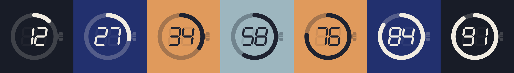

# DAYpercent

A minimalist clock that shows how much of the day has passed as a percentage, with a background that shifts with the light of the day.

00:00 is 0%, 12:00 is 50%, 18:00 is 75%. Each 1% is 14 minutes and 24 seconds.

The background follows the light: night, blue hour, golden hour and day, then golden hour, blue hour and night again.

DAYpercent by edSELVA & TOTI
